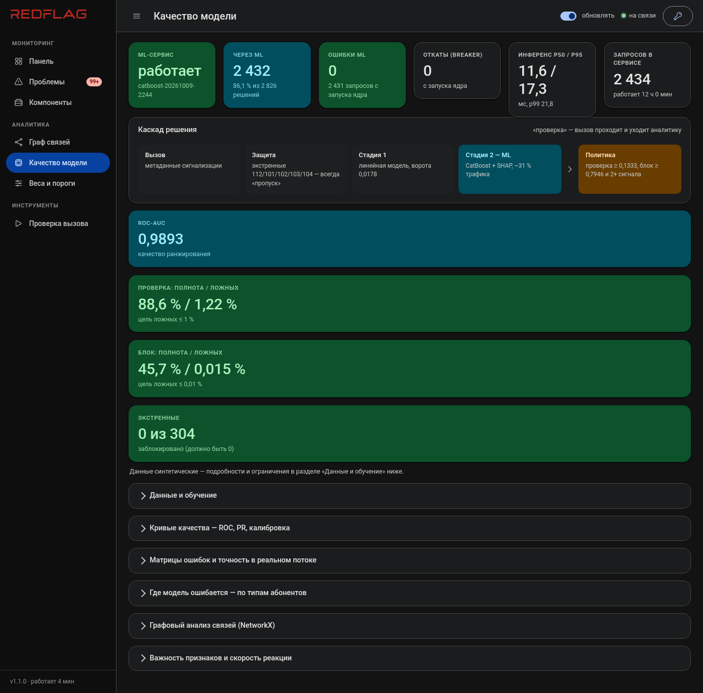
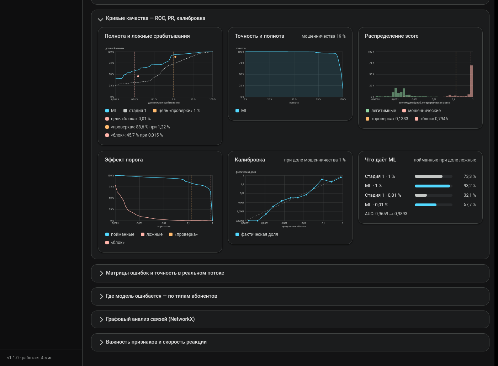

# Обучение модели

Этот документ — про то, как система учится отличать мошеннический вызов от легитимного: откуда берутся
данные, почему стадий две, как устроен конвейер обучения и что на самом деле означают цифры в отчёте.
Если нужны только текущие результаты — смотрите раздел «Результат» ближе к концу; если нужно понять,
почему система устроена именно так — читайте по порядку.

## Почему синтетика, а не реальные данные

У организаторов кейса нет размеченного трафика — это не секрет и не временная проблема, а исходное
условие задачи: «найдите мошенничество сами». Реальных звонков с меткой «это фрод» попросту не
существует ни у нас, ни у жюри. Значит, либо не обучать модель вообще и полагаться только на жёсткие
правила, либо построить генератор, который умеет честно создавать и фрод, и — что гораздо важнее —
легитимный трафик, похожий на фрод ровно настолько, насколько он похож на фрод в реальной сети.

Вторая часть сложнее первой. Сделать генератор, который рисует «нормальных» абонентов и «подозрительных»
абонентов, отличимых одним простым порогом — пара часов работы, и бесполезный результат: модель научится
этому игрушечному порогу и будет бесполезна на реальных данных, а метрики будут красивыми и лживыми.
Поэтому `internal/lab/synth` целенаправленно генерирует **трудные легитимные случаи** — колл-центры с
сотнями вызовов в час, банковские оповещения, рассылающие тысячи коротких звонков волнами, курьерские
службы с короткими разговорами, корпоративных абонентов с десятками номеров на одного владельца, ночных
диспетчеров с преобладающей ночной активностью, разовые оповещения ЖКХ и МЧС — каждый из них специально
сконструирован так, чтобы задевать один или два признака мошенничества, но оставаться легитимным по сути.
Без них модель выучивает «много и быстро — значит плохо» и блокирует call-центр заказчика в первый же
день эксплуатации.

Пять из этих трудных случаев — не наша придумка, а прямое требование материалов кейса (раздел
«легитимные ловушки», D1–D5); остальные добавлены по тому же принципу для не описанных в кейсе, но
реалистичных ситуаций (роуминг, SIP-транки). Коротко о мошеннических типах и о четырёх структурных —
клоне SIM, цепочке переадресации, SIM-box и карусели — которые появились позже остальных и требовали
нового слоя графовых детекторов, рассказано в [ADR-0019](adr/0019-case-dataset-detectors.md); история
о том, как раньше уже обожглись на недостаточно разнообразной синтетике — в
[ADR-0013](adr/0013-synthetic-roamer.md).

Генератор детерминирован по `Seed`: один и тот же сид всегда даёт один и тот же набор вызовов, вплоть до
`call_id`. Это не про воспроизводимость ради воспроизводимости — три независимых сида (обучение,
калибровка, тест) гарантируют, что ни один номер не встречается больше чем в одном из трёх наборов, то
есть модель не может банально запомнить конкретный номер вместо того, чтобы выучить паттерн поведения.

## Каскад: зачем две стадии, а не одна

Одна быстрая и грубая модель или одна медленная и точная — всегда компромисс. Система использует обе
сразу, по принципу «разделяй нагрузку по трудности случая»:

| | Стадия 1 (Go, линейная) | Стадия 2 (Python, CatBoost) |
|---|---|---|
| Задержка | единицы микросекунд | около 8 мс (с объяснением через SHAP) |
| Кому решает | почти весь трафик | только спорные вызовы (серая зона, ~30%) |
| Объяснение | точное разложение: вклад = вес × отклонение от эталона | TreeSHAP — точный, не приближённый |
| Если ML недоступен | решает сама, без деградации | — (откат на стадию 1) |

Абсолютное большинство вызовов — это либо очевидно нормальный разговор, либо очевидный фрод: для них
простая линейная модель с жёстко закреплёнными знаками весов (рост признака риска не может снижать
оценку — это гарантируется ограничениями при обучении, а не проверяется постфактум) отрабатывает за
микросекунды и даёт понятный, проверяемый ответ. Трудные, пограничные случаи — где признаки
противоречат друг другу, например долгий разговор с явно поддельного номера — уходят во вторую стадию,
где CatBoost с деревьями решений и честным SHAP-разложением может учесть нелинейные взаимодействия
признаков, которые линейная модель принципиально не видит.

Это не просто экономия ресурсов (хотя прогонять через тяжёлую модель с Python-сервисом весь трафик
колл-центра было бы расточительно): это ещё и отказоустойчивость. Если ML-сервис недоступен —
таймаут, авария, откат на предыдущую версию — система не падает и не блокирует вслепую, а продолжает
работать на стадии 1 с чуть более грубой, но рабочей оценкой. Решение, какие вызовы считать «спорными»,
принимают **ворота каскада**: вызов уходит в ML, если оценка стадии 1 не ниже порога ворот или сработал
хотя бы один сильный структурный сигнал (о сигналах — ниже). Порог ворот подбирается не произвольно, а
по целевой полноте: не менее 99,5% мошеннических вызовов без явного структурного сигнала должны попасть
в ML, если при этом доля трафика, уходящего в тяжёлую модель, не превышает установленный потолок
нагрузки — если превышает, ворота честно поднимаются, и это видно в отчёте как потеря полноты, а не
прячется.

## Признаки (31 штука)

Признаки делятся на три уровня — от «мгновенно известно по одному вызову» до «видно только по графу
связей за время»:

**По самому вызову** — не требуют истории: длительность разговора, короткий ли вызов, отбой на первой
секунде, был ли вызов отвечен, ночное ли время, пришёл ли вызов из-за рубежа, шёл ли через
международный транзит, подмена номера (заявленный российский CLI при иностранном входе), номер вне
распределённых диапазонов, нечитаемый («скрытый») номер звонящего, расхождение оператора по
сигнализации и по справочнику.

**По номеру за скользящее окно (1 час и 24 часа)** — требуют состояния: число вызовов, число уникальных
собеседников, доля новых (ранее не встречавшихся) адресатов, охват регионов и энтропия их распределения
(обзвон по всей стране — сильнее подозрителен, чем обзвон одного региона), доля коротких и доля
неотвеченных вызовов, «машинность» ритма звонков (насколько равномерны интервалы между вызовами —
человек так не звонит), нагрузка на получателя за тот же час.

**По графу связей** — самые медленно формирующиеся, но и самые надёжные: участие в «веере» (группа
номеров с общим шаблоном поведения и почти непересекающимися списками адресатов) и размер этого веера,
число «лишних» номеров у одного абонента, число «лишних» IMSI на одном номере (признак клонирования
SIM), участие в цепочке переадресаций и глубина этой цепочки, участие в SIM-box (только исходящие
вызовы, собеседник каждый раз новый, входящих не бывает совсем) и участие в закрытой группе-карусели
(номера звонят только друг другу).

Последние четыре графовых признака — клон SIM, цепочка переадресации, SIM-box, карусель — не просто
признаки модели, а часть `decide.HardSignals`: при их срабатывании вердикт поднимается минимум до
«проверки» **независимо от того, что скажет модель**. Это сознательное решение: структурная улика (на
номере физически несколько SIM-идентификаторов, номер стоит звеном цепочки переадресации) — это не
вероятностное предположение, которое может быть ошибочным, а прямое наблюдаемое обстоятельство, и
снижать его вес до «мнения модели» было бы неправильно по существу, а не только менее безопасно.

## Как устроено обучение

```
make retrain NUMPLAN=/путь/к/справочнику
```

Запускает `scripts/retrain.sh`, который прогоняет весь конвейер в четыре прохода, и порядок здесь важен
не формально, а по сути:

1. **Выгрузка признаков боевым движком.** Не отдельный скрипт для обучения, а тот же `internal/decision/engine`,
   что работает в проде — признаки для обучения считаются ровно тем же кодом, что считает их на живом
   трафике. Это убирает целый класс ошибок «в проде код чуть другой, чем при обучении», который
   преследует множество ML-систем.
2. **Обучение линейной стадии 1** — логистическая регрессия со связанными по знаку границами весов: если
   признак по смыслу не может снижать риск (например, число вызовов в час), его вес при обучении не
   может стать отрицательным, какие бы случайные корреляции ни нашлись в данных. Это не защита от
   переобучения ради самой защиты, а требование объяснимости: вес, противоречащий здравому смыслу, было
   бы нечем обосновать перед регулятором.
3. **Повторная выгрузка** — с уже обученной стадией 1: оценка `s1` и сработавшие сильные сигналы в
   датасете для второй стадии считаются не экспертными весами-заглушками, а настоящей обученной моделью,
   иначе вторая стадия училась бы на несуществующем входе.
4. **Обучение CatBoost** с монотонными ограничениями (тот же принцип «рост признака риска не может
   снижать оценку», но уже для деревьев решений), ранней остановкой по отложенной выборке, разбитой по
   номерам, а не по вызовам — иначе два вызова одного и того же тестового номера могли бы попасть один
   в обучение, другой в проверку, и модель бы частично «подсмотрела» ответ. Дальше — калибровка Платта
   под ожидаемую долю мошенничества в реальном трафике (не в обучающей выборке, где фрода нарочно больше
   ради статистической значимости), подбор порогов `review`/`block` по целевой доле ложных срабатываний,
   и подбор порога ворот каскада.

Как только появятся реальные размеченные данные — `make retrain NUMPLAN=… DATA=labeled.csv`;
`internal/telecom/ingest` умеет гибко читать CSV и JSONL с разными названиями колонок, так что переход с
синтетики на реальный поток не потребует переписывать пайплайн.

### Почему пороги подбираются по FPR, а не по AUC

ROC-AUC — хорошая сводная метрика, но она ничего не говорит о том, что увидит конкретный абонент
конкретного банка, чей номер система один раз пометила «проверкой». Кейс явно требует «акцент на долю
ложных срабатываний» — поэтому пороги `review` и `block` подбираются не по лучшему AUC и не по лучшему
F1, а по прямому попаданию в целевую долю ложных срабатываний среди легитимного трафика (по умолчанию:
не более 1% легитимных вызовов — в «проверку», не более 0,01% — в «блок»). Это калибровочная процедура,
отдельная от обучения самой модели: сначала учим модель отличать классы, потом отдельно решаем, где
провести черту, исходя из цены ошибки, а не из абстрактного качества ранжирования.

`block` вообще устроен иначе, чем «`review` с порогом повыше» — для него дополнительно требуется не
менее двух независимых сильных сигналов, и защищённые классы (экстренные службы, проверенные номера)
не блокируются никогда, какой бы ни был score. Подробный разбор цены ошибки автоблокировки — в
[safety.md](safety.md).

## Результат (синтетика, независимый набор)

Модель `catboost-20261009-2244`: ROC-AUC 0,9893; review: полнота 88,6% при ложных срабатываниях 1,22%;
block: полнота 45,7%, 27 ложных блокировок из 180 117; в ML уходит 31,4% трафика; экстренных
заблокировано 0 из 304. Полный отчёт обучения — `services/ml/models/report.md` на сервере, структура
отчёта описана ниже.

Те же цифры с одного взгляда — экран «Качество модели» панели (живой снимок с боевого стенда):



А это — раскрытый раздел «Кривые качества» того же экрана: ROC и PR-кривые, распределение score,
эффект порога, калибровка и вклад ML относительно одной линейной стадии:



Предыдущая версия (`catboost-20261009-1603`) целилась в 1% ложных срабатываний по review, а на
независимой тестовой выборке давала 1,69% — порог подбирается квантилем на калибровочной выборке, а
измеряется на отдельной тестовой, и с появлением редких трудных легитимных типов (ночные дежурные,
разовые оповещения ЖКХ/МЧС — по 0,5–0,7% обучающей выборки каждый) разрыв между ними перестал быть
мелочью. Исправлено не косметически: `fit_thresholds` (`services/ml/training/evaluate.py`) теперь
целится на калибровке не в номинальный target, а в `target × review_margin` (по умолчанию 0,6) — запас
на разрыв между калибровкой и тестом. Эффект виден в цифрах: FPR на тесте упал с 1,69% до **1,22%**,
полнота просела всего на 0,8 процентных пункта (89,4% → 88,6%) — разумная цена за то, что система
действительно держится около заявленной цели, а не превышает её почти в полтора раза. 0,6 — не точная
наука, а консервативная оценка по единственному наблюдению; если при будущих переобучениях разрыв между
калибровкой и тестом окажется систематически другим, margin стоит поправить — комментарий в коде
объясняет, как.

Заодно это дало побочный эффект на трудных легитимных типах: ложная «проверка» у разового оповещения
ЖКХ/МЧС упала с 6,55% до 0,13%, у ночных дежурных — до 0,00%. Не потому, что модель стала лучше отличать
именно эти случаи — просто более строгий общий порог реже задевает любой пограничный легитимный трафик,
включая их.

Линейная стадия 1 отдельно показывает интересный и честный случай: `chain_member` и `chain_depth`
получают нулевой вес (редкие строки в обучающей выборке — L2-регуляризация обнуляет слабо
представленный признак, это свойство конкретно линейной регрессии, а не изъян всей системы). Защиту это
не снижает: оба признака входят в `decide.HardSignals` и поднимают вердикт до `review` независимо от
веса модели — структурная улика сама по себе достаточна. А в CatBoost (стадия 2, решает спорные
вызовы) оба признака уже содержательны (`chain_member` 0,39, `chain_depth` 0,65), а структурные признаки
SIM-box и карусели вообще вошли в число самых важных в модели (`carousel_member` 4,74, `simbox_member`
0,99 — `carousel_member` заметно выше классического `spoof`, 0,74). Иначе говоря: там, где простая модель
признак не видит, его видит дерево решений, а там, где не видит и оно — его всё равно видит жёсткое
правило.

## Независимая проверка на чужих данных

Метрики выше посчитаны на независимом наборе, но из **того же** генератора — это честная проверка на
переобучение, но не проверка того, не выучила ли модель артефакты именно нашего генератора вместо
универсальных признаков мошенничества. Отдельно, на действительно внешнем датасете другой природы
(FraudZen — открытый генератор CDR для bypass/SIM-box-фрода, независимый от этого проекта) модель не
работает (AUC 0,54 вместо 0,988), и известно почему: другой поведенческий паттерн мошенничества — тихий,
низкообъёмный, намеренно маскирующийся под обычного абонента, вне охвата признаков, заточенных под
объёмные атаки. Полный разбор, методика эксперимента и честный вывод — в
[docs/external-validation.md](external-validation.md); он написан не для галочки, а потому что команда
уже один раз обожглась на синтетике, не проверенной на внешних данных (см. ADR-0013).

## Графовый анализ сети (NetworkX)

Отдельно от боевого каскада: `services/ml/training/graphfeat.py` строит граф вызовов всего обучающего
набора (`caller → callee`) и независимо от онлайн-эвристики Go ищет «веер» графовыми методами
(NetworkX), без ограничения на скользящее окно — это не признак модели и не используется в скоринге, а
раздел отчёта обучения для самопроверки: структура сети целиком (компоненты связности, степени вершин,
сообщества) и сверка с `fan_member` — насколько online-эвристика, работающая только в пределах
часового окна, соответствует офлайн-анализу, которому видна вся история сразу. Расхождения ожидаемы и
объяснимы (эвристика физически не может увидеть паттерн, который размазан по времени шире окна), но
само наличие этой сверки — способ поймать систематическую ошибку эвристики, если она появится.
Подробности и ограничения — в [ADR-0018](adr/0018-networkx-graph-analysis.md).

## Отчётность по модели (раздел «Качество модели» панели)

Каждое обучение (`training.train`) пишет рядом с моделью `report.json` — машиночитаемую версию
`report.md` с добавленными кривыми для графиков:

- ROC (полнота против ложных срабатываний, логарифмическая шкала по оси FPR) отдельно для ML и для
  линейной стадии 1, плюс PR-кривая;
- распределения score легитимных и мошеннических вызовов, эффект каждого возможного порога, калибровка
  (с поправкой на ожидаемую долю мошенничества в реальном трафике, а не в обучающей выборке);
- матрицы ошибок отдельно для «проверки» и для «блока», точность при разной доле мошенничества в потоке;
- ложные срабатывания по каждому типу легитимных абонентов и полнота обнаружения по каждому типу
  мошенничества, скорость реакции на номер-нарушитель, статистика самого каскада (доля трафика в ML,
  доля, поднятая правилом, число экстренных вызовов);
- важность признаков, параметры обучения и происхождение данных (синтетика или размеченный файл — это
  явно записано в отчёте, а не подразумевается).

ML-сервис отдаёт файл через `GET /v1/report` (404, если модель обучена без отчёта) и собственные
счётчики через `GET /v1/stats` (число запросов, ошибок, перцентили задержки инференса). Ядро проксирует
их как `GET /v1/ml/report` (с кэшем на 30 секунд, чтобы не дёргать ML-сервис на каждое открытие панели)
и `GET /v1/ml/service`; панель показывает это всё на экране «Качество модели» — живое состояние сервиса, схему
принятия решения и отчёт целиком. Если ML не подключён — ответ 503, если у модели нет отчёта — 404 с
подсказкой переобучить, а не молчаливая пустая страница.

Метрики отчёта всегда считаются на независимой выборке, не участвовавшей ни в обучении, ни в подборе
порогов — иначе цифры были бы красивыми, но бессмысленными. Пока данные синтетические, раздел панели
прямо сообщает об этом (`data.synthetic`), и это не формальность: как только появятся реальные данные,
этот флаг исчезнет, и будет видно, что изменилось.
